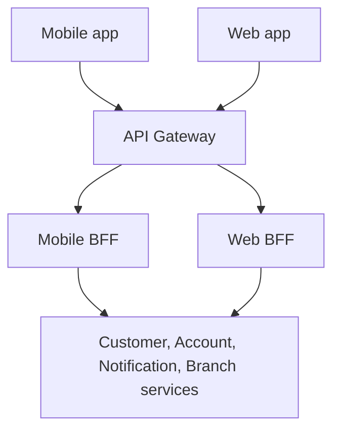

# Backend for Frontend (BFF)

> A Backend for Frontend is a backend layer designed around the needs of a
> particular frontend.

A mobile banking app, customer web application, and branch employee portal may
use the same backend services. Their screens, workflows, and data needs can
still differ. A BFF gives a frontend APIs tailored to those needs.


---

## 1. Start with the problem

Suppose a mobile banking home screen displays:

- Customer's display name
- Account summaries
- Unread notification count
- Home branch name

The authoritative data lives in separate services:

| Service              | Data it owns          |
|----------------------|-----------------------|
| Customer Service     | Customer profile      |
| Account Service      | Accounts and balances |
| Notification Service | Notifications         |
| Branch Service       | Branch details        |

Without an aggregation layer, the mobile app might make four requests through
the gateway and combine their results. It must coordinate completion, errors,
loading indicators, and response formats.

On a slower mobile connection, extra round trips and payload size may be
noticeable. A BFF can offer one screen-oriented endpoint:

```http
GET /mobile/home
```

The BFF calls the required services and constructs the mobile response. Backend
calls still exist, but their coordination moves from the device to the BFF.

---

## 2. Architecture flow diagram



This is one possible deployment. The gateway and BFF do not always need to run
as separate processes. Start from the responsibilities and deployment needs;
do not add components simply to reproduce a diagram.

### Responsibilities

| Layer           | Main concern                                                   | Banking example                                              |
|-----------------|----------------------------------------------------------------|--------------------------------------------------------------|
| API Gateway     | Routing, shared access policies, rate limits, traffic handling | Route `/mobile/**` to the Mobile BFF.                        |
| BFF             | Client-specific APIs, aggregation, response shaping            | Combine home-screen data into one mobile response.           |
| Domain services | Business rules, transactions, authoritative data               | Enforce account access and provide correct account balances. |

The gateway can use discovery and balancing to reach BFF instances. A BFF can
use the platform's discovery/routing mechanisms to reach its dependencies.
Eureka remains responsible for discovery information, not home-screen assembly.

---

## 3. A concrete banking example

### Mobile app: compact overview

A small screen may need only:

```json
{
  "displayName": "Mohan",
  "totalAvailableBalance": {
    "amount": "12500.00",
    "currency": "INR"
  },
  "unreadNotificationCount": 3
}
```

### Web application: detailed overview

A larger screen may need account details and recent activity:

```json
{
  "displayName": "Mohan",
  "accounts": [
    {
      "accountId": "ACC-101",
      "type": "SAVINGS",
      "availableBalance": {
        "amount": "12500.00",
        "currency": "INR"
      }
    }
  ],
  "recentTransactions": [],
  "unreadNotificationCount": 3
}
```

The Account Service remains the owner of balances and their business meaning.
Any financial aggregation must use defined domain rules; do not casually add
balances in different currencies inside the BFF.

The BFF selects and assembles data for the frontend. Returning fewer fields does
not replace checking whether the caller may access those accounts.

---

## 4. What a BFF can do

A BFF may:

- Combine responses from several services.
- Return only the fields a frontend needs.
- Adapt pagination and response structure.
- Coordinate independent read calls.
- Handle optional information being unavailable.
- Provide endpoints aligned with client screens or workflows.

For example, the mobile team might need a compact paginated transaction list,
while the employee portal needs a different view with different permissions.
Each BFF can tailor presentation without duplicating the transaction domain.

### Keep business ownership clear

The BFF should not duplicate core rules such as:

- Calculating available balance
- Validating whether a transfer is permitted
- Enforcing account ownership from authoritative data
- Debiting and crediting accounts
- Owning the transfer transaction or ledger

Those rules belong in domain services. A BFF can participate in access checks
and pass trusted caller context, but the domain service must still enforce the
authorization relevant to its resources.

---

## 5. Latency and partial failure

A BFF reduces frontend coordination, but adds another backend component and
network hop. One frontend request can fan out into several backend calls.

### Sequential vs concurrent reads

Calling four services sequentially accumulates their waiting times. Independent
reads can often run concurrently, with bounded concurrency and individual
timeouts.

Do not parallelize a call whose input depends on an earlier response. For
example, finding a customer's home-branch ID may need to complete before the
branch-detail lookup.

Define an overall response deadline. If a downstream call hangs, the BFF should
not wait indefinitely.

### Decide which data is essential

| Home-screen data      | Example importance | Failure behavior                                                           |
|-----------------------|--------------------|----------------------------------------------------------------------------|
| Account information   | Essential          | Return an explicit failure or unavailable state according to the contract. |
| Customer display name | Product-dependent  | Use a defined fallback or unavailable state if allowed.                    |
| Notification count    | Often optional     | Omit or mark unavailable; do not pretend an unknown count is zero.         |
| Branch display name   | Often optional     | Omit or mark unavailable if the screen can still function.                 |

The product decides these priorities. A failed account lookup must not be
represented as a zero balance. If returning partial data, make the response
contract explicit so the frontend can distinguish missing, stale, and valid data.

Trace the BFF's downstream calls and measure its response latency, dependency
errors, and fan-out. One client request can generate substantial backend load.

---

## 6. When should we use a BFF?

A BFF is useful when:

- Web and mobile clients have materially different data needs.
- Screens repeatedly combine multiple service responses.
- Client-specific payloads or workflows change independently.
- There is clear ownership for the frontend-specific API.

It may be unnecessary when:

- One frontend can use a small, stable set of existing APIs directly.
- Client requirements are similar enough to share the same API.
- There is little aggregation or adaptation work to perform.
- Another component already provides the required client-facing contract cleanly.

Do not create a BFF merely because the backend uses microservices. Conversely,
do not push all screen-specific aggregation into domain services just to avoid
another layer.

---

## 7. Practice: design `GET /mobile/home`

For our banking application, answer:

1. Which information is essential to the home screen?
2. Which backend services must the BFF call?
3. Which calls can run concurrently?
4. What happens if Notification Service fails?
5. How will account authorization be preserved and the request traced?

These questions connect BFF design to requirements, latency budgets, bounded
concurrency, partial failure, authorization, and observability.

## Quick revision

| Concept          | Remember                                                       |
|------------------|----------------------------------------------------------------|
| BFF              | API layer tailored to a frontend's needs                       |
| Gateway          | Shared traffic and API policies                                |
| Aggregation      | Combine service responses for the client                       |
| Response shaping | Return the format and fields that client needs                 |
| Domain service   | Own business correctness and authoritative data                |
| Partial failure  | Decide what is essential and represent missing data truthfully |

> A BFF simplifies the frontend by moving client-specific coordination to a
> backend layer, while keeping domain rules in the services that own them.
