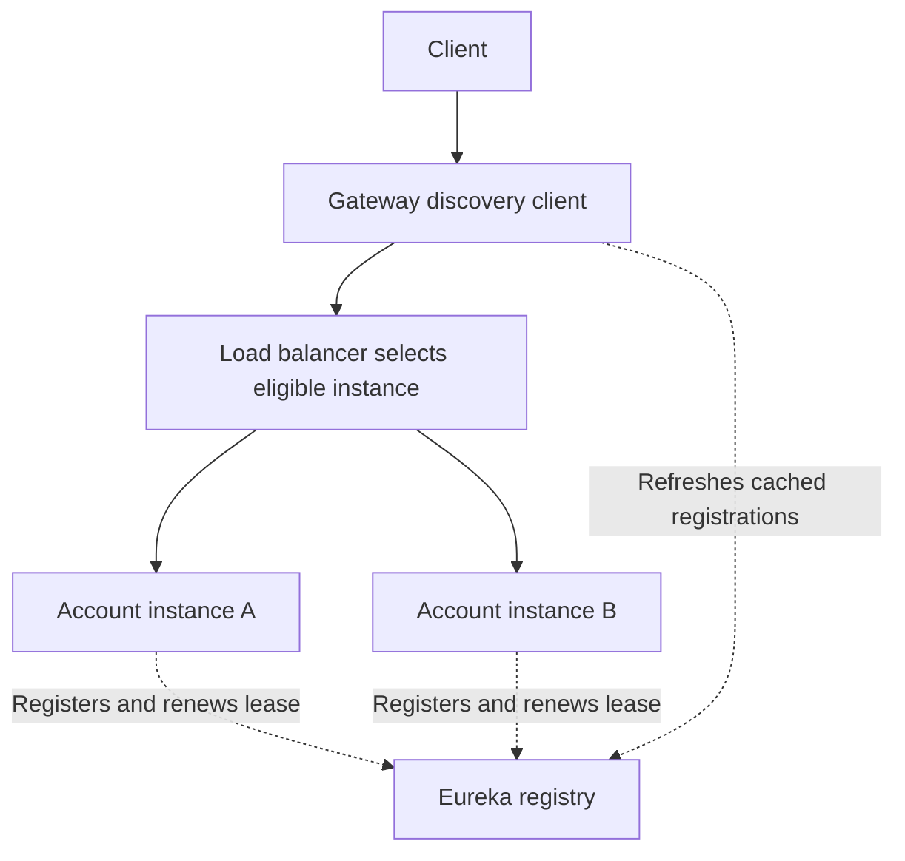

# Service Discovery and Eureka

> Service discovery lets an application locate instances of another service
> without hard-coding every instance address.

Discovery provides addresses. Load balancing selects an instance. An HTTP
client or gateway sends the request. These responsibilities work together, but
they are different.

---

## 1. The problem: service instances change

Suppose Account Service initially runs at:

```text
10.10.1.10:8103
```

Later, the team adds another instance:

```text
10.10.1.20:8103
```

Instances can restart, move, scale, or become unavailable. If every caller
maintains its own address list, these changes become difficult to coordinate.

Fixed URLs are possible, but maintaining changing instance addresses manually
is brittle. Service discovery is one solution; stable DNS/proxy endpoints are
another. Not every application needs Eureka.

---

## 2. Core vocabulary

| Term                 | Meaning                                        | Example                                                 |
|----------------------|------------------------------------------------|---------------------------------------------------------|
| Service              | A logical application capability               | `account-service`                                       |
| Service instance     | One running copy of that application           | `10.10.1.10:8103`                                       |
| Service registry     | Directory of registered instances and metadata | Eureka Server                                           |
| Discovery client     | Retrieves instance information for a caller    | Eureka client in Gateway or Customer Service            |
| Load balancer        | Selects from eligible instances                | Spring Cloud LoadBalancer                               |
| Request client/proxy | Sends traffic to the selected address          | Gateway HTTP client or a configured service HTTP client |

Two instances of one service should normally use the same service name and
different instance identities. Running a second instance does not create a new
logical business service.

---

## 3. Our banking deployment

| Application            | Server A: `10.10.1.10` | Server B: `10.10.1.20` |
|------------------------|------------------------|------------------------|
| Eureka, learning setup | `:8761`                | —                      |
| API Gateway            | `:8080`                | —                      |
| Config Service         | `:8888`                | —                      |
| Branch Service         | `:8101`                | —                      |
| Customer Service       | `:8102`                | `:8102`                |
| Account Service        | `:8103`                | `:8103`                |
| Notification Service   | `:8104`                | —                      |

Processes sharing the same host network need distinct listening endpoints.
The same port can be reused on another host. Container networking can change
the arrangement, but registered addresses must remain reachable by callers.

Eureka might show:

```text
ACCOUNT-SERVICE
    account-service:10.10.1.10:8103
    account-service:10.10.1.20:8103
```

Both entries represent Account Service. The address and instance ID distinguish
the copies.

---

## 4. Discovery traffic vs business traffic



Dashed edges represent registration/discovery communication. Solid edges
represent business-request routing.

Eureka normally does not proxy the account request or return the account
response. The gateway uses discovered information to connect to Account Service.

**Memory aid:** Eureka is the address directory, not the road through which
every business request travels.

---

## 5. Complete instance lifecycle

1. **Start:** The application starts its web server and initializes components.
2. **Register:** It advertises its service name, instance ID, address, port, and metadata.
3. **Publish status:** Its registration indicates whether it is eligible for traffic.
4. **Propagate:** Registry information reaches callers through refresh/caching mechanisms.
5. **Serve:** A caller selects the instance and connects to it.
6. **Renew:** The instance periodically sends heartbeats to renew its lease.
7. **Leave:** Graceful shutdown can deregister it; an abrupt crash cannot send that notification.
8. **Converge:** Registry and caller views eventually reflect the change.

Starting, registering, becoming ready, and becoming visible to callers are
separate events. Do not assume a new instance receives traffic immediately.

---

## 6. Standalone Eureka Server: local learning setup

Use compatible Spring Boot and Spring Cloud versions, with dependency management
from the matching Spring Cloud BOM.

### Dependency

```xml
<dependency>
    <groupId>org.springframework.cloud</groupId>
    <artifactId>spring-cloud-starter-netflix-eureka-server</artifactId>
</dependency>
```

### Application

```java
import org.springframework.boot.SpringApplication;
import org.springframework.boot.autoconfigure.SpringBootApplication;
import org.springframework.cloud.netflix.eureka.server.EnableEurekaServer;

@SpringBootApplication
@EnableEurekaServer
public class ServiceRegistryApplication {

    public static void main(String[] args) {
        SpringApplication.run(ServiceRegistryApplication.class, args);
    }
}
```

### `application.yml`

```yaml
spring:
  application:
    name: service-registry

server:
  port: 8761

eureka:
  client:
    register-with-eureka: false
    fetch-registry: false
```

Dashboard for a local process:

```text
http://localhost:8761
```

The two client flags suit a standalone learning registry. They are not the
configuration for peer-replicated servers.

Security, network access, and HTTPS configuration must match the environment.
Do not expose registry or instance-management endpoints openly to the internet.

---

## 7. Register an Account Service instance

### Dependency

```xml
<dependency>
    <groupId>org.springframework.cloud</groupId>
    <artifactId>spring-cloud-starter-netflix-eureka-client</artifactId>
</dependency>
```

With the supported Spring Cloud auto-configuration, the client starter and
configuration are sufficient. A separate `@EnableEurekaClient` annotation is
not required in modern setups.

### `application.yml`

```yaml
spring:
  application:
    name: account-service

server:
  port: ${SERVER_PORT:8103}

eureka:
  client:
    register-with-eureka: true
    fetch-registry: true
    service-url:
      defaultZone: http://10.10.1.10:8761/eureka/

  instance:
    prefer-ip-address: true
    ip-address: ${SERVICE_IP}
    instance-id: "${spring.application.name}:${eureka.instance.ip-address}:${server.port}"
```

Set `SERVICE_IP=10.10.1.10` on Server A and `SERVICE_IP=10.10.1.20` on Server B.
Keep the service name the same.

This is one IP-based example. A correctly resolvable hostname is also valid.
The gateway must reach the advertised address/port; successful registration
alone does not prove connectivity.

### Common registration mistakes

- Advertising `localhost` for a caller on another host.
- Advertising a container-only address to a caller outside that network.
- Selecting the wrong interface on a host with several network interfaces.
- Registering duplicate instance IDs.
- Advertising a port different from the reachable application port.
- Using `default-zone` instead of the case-sensitive `defaultZone` map key.

### Registration and discovery can be independent

| Setting                | Responsibility                                             |
|------------------------|------------------------------------------------------------|
| `register-with-eureka` | Publish this application's instance registration.          |
| `fetch-registry`       | Retrieve discovery information for calling other services. |

A consumer can fetch registrations without advertising itself. Whether the
gateway needs registration depends on how its own callers find it.

---

## 8. How a caller uses discovery

### Gateway route

An explicit route can target a logical service:

```yaml
- id: account-route
  uri: lb://account-service
  predicates:
    - Path=/api/accounts/**
  filters:
    - StripPrefix=1
```

This is a route fragment. Place it under the route prefix supported by the
Gateway version and variant in your project. The gateway also needs the Eureka
client and Spring Cloud LoadBalancer support.

For `/api/accounts/100`, the gateway matches the route, selects a discovered
Account instance, and forwards `/accounts/100`.

### Direct service-to-service calls

Customer Service can also discover Account Service without using the gateway.
It needs a client integrated with discovery and balancing, such as an
appropriately configured Feign or Spring HTTP client.

A plain HTTP client does not gain discovery simply because Eureka is on the
classpath. Likewise, `http://account-service` only works if the client or network
environment knows how to resolve that logical name.

### Diagnostic inspection

Spring's `DiscoveryClient` can inspect registered instances:

```java
List<ServiceInstance> instances =
        discoveryClient.getInstances("account-service");
```

This demonstrates discovery. Do not build normal balancing by always taking
`instances.get(0)`; use the configured load-balancing client and handle the
no-instance case.

---

## 9. Caching and eventual discovery updates

Eureka maintains registration information, and callers maintain local cached
views. Changes take time to propagate.

Suppose Gateway's cached list contains:

```text
Account A: running
Account B: recently crashed, but still in cached discovery information
```

Gateway can attempt a call to B until its eligible-instance view changes or
another configured failure-handling mechanism prevents selection.

Therefore:

- Discovery provides candidate addresses; it cannot guarantee each connection succeeds.
- Callers still need connection/response timeouts.
- Retries must be bounded and safe for the business operation.
- New instances may not be used immediately.
- Graceful deregistration is not instantly visible everywhere.

### Timing values to understand

Common Eureka settings include the following; verify defaults for the version
and deployment configuration in use:

| Setting                                                | Common default | Meaning                                                 |
|--------------------------------------------------------|---------------:|---------------------------------------------------------|
| `eureka.instance.lease-renewal-interval-in-seconds`    |     30 seconds | How frequently an instance renews its lease.            |
| `eureka.instance.lease-expiration-duration-in-seconds` |     90 seconds | Lease-expiration threshold after missing renewals.      |
| `eureka.client.registry-fetch-interval-seconds`        |     30 seconds | How frequently a client refreshes registry information. |

**A 90-second lease setting is not a promise that callers stop using a crashed
instance exactly 90 seconds after the crash.** Eviction processing, caching,
refresh schedules, network conditions, and self-preservation affect timing.

Do not reduce all intervals aggressively to make a demo look instantaneous.
Measure the behavior and understand the coordination/network cost.

---

## 10. Heartbeats, health, readiness, and statuses

### Heartbeat

The instance communicates with Eureka and renews its registration lease. This
does not prove its database, downstream APIs, or business transactions work.

### Application health

Actuator indicators can describe application dependencies. Spring Cloud Eureka
can integrate application health with its published status; behavior and
defaults should be verified against the selected version.

Where applicable, enable the supported integration in `application.yml`:

```yaml
eureka:
  client:
    healthcheck:
      enabled: true
```

Include the required Actuator support. This does not mean Eureka Server begins
actively polling every advertised health URL. A health URL in metadata is not
by itself proof that active health checking is enabled.

### Readiness

Readiness asks whether an instance should receive new traffic. A generic
aggregate health result and readiness are not automatically identical. Define
how application state maps to Eureka status and traffic eligibility, especially
for startup and deployments.

### Standard Eureka statuses

| Status           | Intended meaning                              |
|------------------|-----------------------------------------------|
| `UP`             | Eligible to receive traffic                   |
| `DOWN`           | Unavailable; do not select for normal traffic |
| `STARTING`       | Initialization is in progress                 |
| `OUT_OF_SERVICE` | Intentionally withdrawn from traffic          |
| `UNKNOWN`        | State is unknown                              |

`MAINTENANCE` is not a standard Eureka instance status. `OUT_OF_SERVICE` can
represent intentional traffic withdrawal. Callers must use instance-selection
behavior that respects eligibility.

---

## 11. Graceful shutdown vs abrupt failure

| Event               | What changes                                                     | Remaining concern                                                 |
|---------------------|------------------------------------------------------------------|-------------------------------------------------------------------|
| Planned shutdown    | The client can signal status/deregistration before exiting.      | Other callers may still hold old information.                     |
| Crash or power loss | No final deregistration message is sent.                         | Missing leases and later updates must reveal the failure.         |
| Network partition   | The registry may miss renewals even though the application runs. | It is hard to distinguish a dead process from lost communication. |

For a planned deployment, coordinate traffic withdrawal, propagation, connection
draining, and graceful application shutdown. Deregistration does not migrate
requests already running on the instance.

---

## 12. Self-preservation

If many expected lease renewals disappear, a network problem may be preventing
communication rather than every service crashing at once. Eureka's
self-preservation behavior can suspend lease expiration-based eviction when
renewal levels fall below its threshold.

This helps avoid mass removal of potentially healthy services. The trade-off is
that stale entries can remain, so callers may still attempt failed addresses.

**Self-preservation is not application self-healing.** It does not restart a JVM,
repair a database, or prove that retained instances are healthy.

Do not disable it in production merely to make failed entries disappear faster.
Understand the environment and failure policy first. A small lab registry can
also behave differently from a large deployment, so record its state during
failure experiments.

---

## 13. What if Eureka itself becomes unavailable?

### Existing caller with cached registrations

It may continue calling known, reachable service instances while discovery
refresh fails. That does not guarantee all requests succeed or that new
instances become visible.

### Newly started caller

A fresh process may have no useful discovery information. Its ability to start
and serve depends on its configuration, reachable registry peers, and other
startup dependencies.

### New or changed service instance

It may be unable to register/update its location. Existing callers cannot rely
on learning that address until the discovery path recovers.

**Registry outage and business-service outage are different failures.** Cached
information helps availability, but it becomes less accurate as deployments and
instances change.

---

## 14. Eureka high availability with peers

Production can run multiple Eureka servers on separate hosts/failure domains.
Peers replicate registration changes. Callers can be configured with more than
one registry endpoint.

For example, assume these hostnames resolve correctly:

```text
eureka-a.internal:8761
eureka-b.internal:8761
```

### Server A configuration

```yaml
spring:
  application:
    name: service-registry

server:
  port: 8761

eureka:
  instance:
    hostname: eureka-a.internal
  client:
    register-with-eureka: true
    fetch-registry: true
    service-url:
      defaultZone: http://eureka-b.internal:8761/eureka/
```

### Server B configuration

```yaml
spring:
  application:
    name: service-registry

server:
  port: 8761

eureka:
  instance:
    hostname: eureka-b.internal
  client:
    register-with-eureka: true
    fetch-registry: true
    service-url:
      defaultZone: http://eureka-a.internal:8761/eureka/
```

### Business-client registry endpoints

```yaml
eureka:
  client:
    service-url:
      defaultZone: http://eureka-a.internal:8761/eureka/,http://eureka-b.internal:8761/eureka/
```

These are illustrative peer configurations. Validate name resolution, security,
network reachability, and peer behavior for your deployment. Do not carry the
standalone server's disabled client flags into this peer example.

Multiple processes on one host are useful for learning, but do not survive that
host's failure. Replication and caching also mean registry views need not be
identical at every instant.

---

## 15. Metadata and locality

Instance metadata can describe zone, version, or other deployment attributes.
This can support locality preferences and controlled selection when callers
interpret it appropriately.

Adding arbitrary metadata does not automatically change routing. A registry
stores the information; the discovery/selection implementation must understand
the field. For example, a custom `version` field does not by itself implement
canary deployment or API version routing.

---

## 16. Discovery approaches and alternatives

| Approach              | Who resolves/selects destinations?                                 | Trade-off                                                               |
|-----------------------|--------------------------------------------------------------------|-------------------------------------------------------------------------|
| Client-side discovery | Caller uses registry information and an instance-selection client. | Caller integration, caches, and selection policy must be managed.       |
| Server-side discovery | Proxy/load balancer resolves backends and forwards calls.          | Central traffic infrastructure needs resilience and configuration.      |
| DNS-based discovery   | Name resolution provides endpoint information.                     | DNS/client caching and health-update behavior affect freshness.         |
| Kubernetes Service    | Platform service names and networking direct traffic to endpoints. | Requires understanding the cluster's networking and readiness behavior. |

In your Gateway/Eureka setup, the gateway is a discovery client and can select
a backend. From the external application's perspective, the gateway provides
a stable server-side entry point. Name the boundary when comparing approaches.

Neither client-side nor server-side discovery is universally more scalable.
Eureka is useful in suitable environments, but a platform's built-in service
discovery may remove the need for a separate Eureka registry.

---

## 17. Troubleshooting and monitoring

| Symptom                                     | Questions to ask                                                                        |
|---------------------------------------------|-----------------------------------------------------------------------------------------|
| Service missing from registry               | Correct service URL, credentials, connectivity, starter, registration flag?             |
| One of two instances is missing             | Same service name but unique instance IDs?                                              |
| Registration is UP but calls fail           | Is the advertised address reachable? Correct port/interface? Is the app actually ready? |
| Traffic continues toward a crashed instance | Lease state, self-preservation, caller cache, supplier/cache refresh?                   |
| New instance gets no traffic immediately    | Has registration propagated? Is it eligible? Does the route use discovery?              |
| Only one backend is ever used               | Fixed-IP route, missing balancing client, custom filters, or incomplete registry view?  |
| Registry fails but some calls still work    | Existing caller may have usable cached registrations.                                   |

Monitor registration/renewal errors, peer connectivity, fetch failures, eligible
instance counts, and caller connection failures. Correlate these with deployment
events and actual service readiness.

Discovery success is not proof of business success. Keep request metrics,
timeouts, tracing, and safe retries alongside registry monitoring.

---

## 18. Controlled practical experiments

Run these in a local/test environment and record observed timings rather than
assuming fixed deadlines.

| Experiment                       | What to observe                                                              |
|----------------------------------|------------------------------------------------------------------------------|
| Start Account instance B         | Registration visibility and when Gateway begins selecting B.                 |
| Stop B gracefully                | Status/deregistration propagation and any in-flight failures.                |
| Kill B abruptly                  | Lease/cached visibility, attempted calls, timeouts, self-preservation state. |
| Stop the registry                | Existing Gateway behavior versus a newly started caller.                     |
| Use an unreachable advertised IP | Registration can succeed while business connections fail.                    |
| Reuse an instance ID             | Registrations may collide instead of representing independent instances.     |
| Stop one registry peer           | Whether clients find another endpoint and registry updates continue.         |

For banking actions, test retry behavior with a safe test endpoint or an
idempotent operation. Do not use real transfers to demonstrate uncontrolled
retries.

---

## Practice questions and reference answers

### 1. Do account requests pass through Eureka?

**Answer:** Normally no. The caller obtains/caches addresses and connects to
the selected Account instance. Eureka participates in discovery communication.

### 2. Why use the same name for two Account Service instances?

**Answer:** The name identifies the logical service. Distinct instance IDs and
addresses identify its interchangeable running copies.

### 3. A service is UP in Eureka, but its database is unavailable. Is this possible?

**Answer:** Yes. Registration/heartbeats do not prove database or business
health. Verify the configured health/status integration and readiness policy.

### 4. Why can a request still target an instance after it crashes?

**Answer:** The crash sends no final deregistration. Lease handling and cached
views take time to update, and self-preservation may retain entries. Callers
still need timeouts and appropriate failure handling.

### 5. Does a registry outage immediately stop every existing request?

**Answer:** Not necessarily. Existing callers may use cached reachable
addresses. New callers, new registrations, and changing instances are more
affected. Results depend on the actual configuration and failure conditions.

### 6. Does a registry restart the failed Account instance?

**Answer:** No. Restarting is the responsibility of a process manager,
orchestrator, deployment platform, or operator. Discovery tracks locations and
status; it does not repair the application.

### 7. Does `uri: http://10.10.1.10:8103` use all Account instances in Eureka?

**Answer:** No. That is a fixed destination. A configured `lb://account-service`
route can use discovery and load balancing.

### 8. Is Eureka required in every Kubernetes deployment?

**Answer:** No. Kubernetes provides its own service naming and networking.
Assess the platform's capabilities and requirements before adding another
registry.

## Quick revision

1. Registry = instance directory.
2. Discovery = locate service instances.
3. Load balancing = choose an eligible instance.
4. Cached discovery information can be stale.
5. Heartbeat is not the same as readiness or business health.
6. Self-preservation retains registrations under certain renewal failures; it does not restart services.
7. Registry peers improve resilience, but callers still need failure handling.
8. Always advertise reachable addresses and use distinct instance identities.

