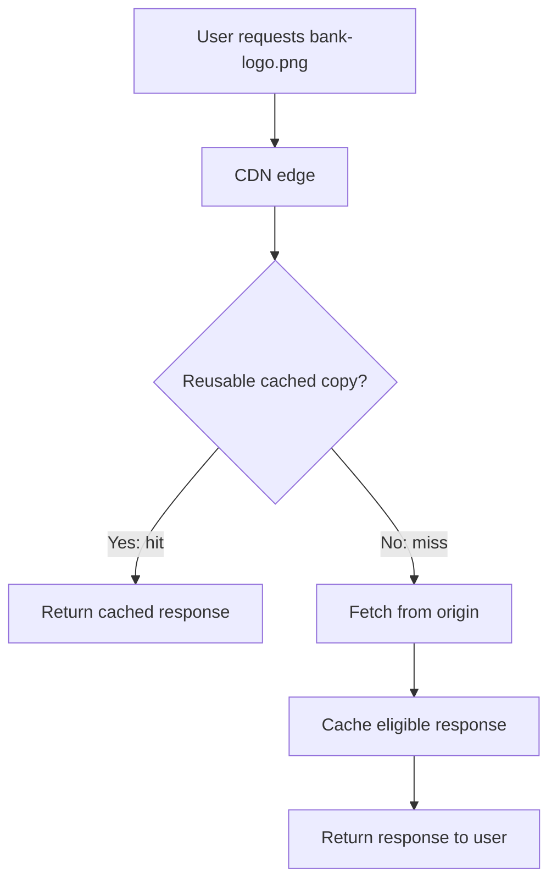

# CDN — Content Delivery Network

> A CDN serves reusable content from distributed locations closer to users,
> improving delivery latency and reducing traffic to the origin.

## 1. Why do we need a CDN?

Imagine our banking application is hosted in Mumbai, while customers access it
from India, Europe, and the US.

Every customer needs the same bank logo, JavaScript files, stylesheets, and public
product images. Sending these files from Mumbai for every request adds network
delay and repeated work at the origin.

A Content Delivery Network maintains distributed delivery locations that can
cache eligible responses and reuse them for subsequent requests.

Example asset:

```text
https://static.bank.example/images/bank-logo.png
```

Without a CDN, requests reach the server hosting the logo. With a CDN, a suitable
edge location can serve a cached copy.

## 2. Important terms

| Term                 | Meaning                                          | Banking example                             |
|----------------------|--------------------------------------------------|---------------------------------------------|
| Origin               | Authoritative source of the content              | Object storage containing the bank logo     |
| Edge location / PoP  | CDN location handling viewer requests            | A location serving users near London        |
| Cached response      | A stored response available for reuse            | A copy of `bank-logo.png`                   |
| Cache hit            | A request can reuse an available cached response | Logo served from edge                       |
| Cache miss           | No suitable cached response is available         | CDN retrieves the logo upstream             |
| TTL                  | Freshness lifetime                               | A response can remain fresh for 300 seconds |
| Cache key            | Identifier used to distinguish cached responses  | Host, path, and selected request attributes |
| Invalidation / purge | Request to remove or invalidate cached content   | Purge an old banner                         |

A CDN typically routes users to a suitable location using network and latency
considerations. The selected location is not necessarily the geographically
closest city.

The origin can be object storage, a web server, a load balancer, or another
supported HTTP endpoint. It does not have to be a Spring Boot application.

## 3. How requests work



### Cache hit

1. The request reaches a CDN location.
2. The cache key matches a stored response.
3. That response is eligible for reuse.
4. The CDN returns it without fetching the body from the origin.

### Cache miss

1. No suitable cached response is available.
2. The CDN requests the content upstream.
3. The origin returns the response.
4. The CDN forwards the response to the user and caches it if permitted.

Providers can have intermediate caches, so an edge miss does not always reach
the original backend. Some can begin streaming content before receiving its
entire body.

### Different locations can have different content

| Request                                  | Cache state                          | Result                           |
|------------------------------------------|--------------------------------------|----------------------------------|
| Customer A requests the logo             | No suitable copy at serving location | Upstream fetch                   |
| Customer B requests the same logo        | Fresh copy available                 | Edge hit                         |
| Customer C requests it in another region | That location has no copy            | Another upstream fetch may occur |

This is caching on demand. Uploading a file does not necessarily distribute it
to every location immediately.

## 4. Benefits and limitations

| Benefit                            | Why it helps                                           |
|------------------------------------|--------------------------------------------------------|
| Lower delivery latency             | Cached content travels from a suitable nearby location |
| Less origin work                   | Hits avoid repeated origin processing and transfers    |
| Better handling of popular content | Many requests can reuse the same response              |
| Reduced origin bandwidth           | Fewer response bodies need to leave the origin         |

A CDN improves the portions of the application it handles effectively. Faster
images do not fix a slow database query behind an account-balance API.

It also introduces operational concerns: stale content, cache-key mistakes,
provider configuration, bandwidth costs, and another delivery dependency.

## 5. Capacity example

Assume:

- 100,000 requests for a 200 KB public image.
- A 95% request cache hit ratio.
- Each request transfers the full image.
- Ignore intermediate caches, revalidation, and protocol overhead.
- Use decimal KB and GB for this estimate.

```text
Requests served from cache = 100,000 × 95% = 95,000
Requests reaching origin  = 100,000 × 5%  = 5,000

Data delivered to users = 100,000 × 200 KB = 20 GB
Origin response data   =   5,000 × 200 KB =  1 GB
```

The CDN still delivers 20 GB to users. It reduces origin work in this simplified
example; it does not eliminate bandwidth or guarantee lower total cost.

Measure request hit ratio and byte hit ratio separately when object sizes vary.
A hit for a small icon and a miss for a large video contribute differently to
request counts and transferred bytes.

## 6. Banking architecture example

A starting design uses separate domains:

| Domain                | Purpose                         | Destination                   |
|-----------------------|---------------------------------|-------------------------------|
| `static.bank.example` | Public images, CSS, JavaScript  | CDN backed by object storage  |
| `api.bank.example`    | Account and customer operations | Load balancer and API gateway |

The browser might request:

```http
GET https://static.bank.example/assets/app.a81f2.js
GET https://api.bank.example/api/accounts/123/balance
```

The browser downloads JavaScript through the CDN. That JavaScript calls the API.
The gateway authenticates and routes the request, and Account Service checks
authorization before retrieving the requested balance.

A production design can also place a CDN in front of API routes, with caching
disabled for sensitive paths.

**Passing through a CDN and being cached by a CDN are separate decisions.**

## 7. What should we cache?

Suggested starting policies for our banking example:

| Content                          | Treatment                   | Reason                                    |
|----------------------------------|-----------------------------|-------------------------------------------|
| Bank logo                        | Cache                       | Same public content for everyone          |
| Versioned JavaScript and CSS     | Long cache lifetime         | New builds use different URLs             |
| Public product images            | Cache                       | Reused across visitors                    |
| Public branch directory          | Consider short caching      | Some update delay may be acceptable       |
| Public interest-rate information | Explicit freshness policy   | Outdated values can mislead customers     |
| Customer balance                 | Bypass shared caching       | Private and current financial information |
| Transaction history              | Bypass shared caching       | Sensitive customer-specific information   |
| Login and transfer responses     | Bypass caching              | Authentication and transaction operations |
| Customer statement PDF           | Controlled private delivery | Static content can still be sensitive     |

**Static does not mean public.** A statement PDF may never change, but only an
authorized customer should be able to access it.

Public APIs can sometimes be cached safely when representation, freshness,
authorization, and invalidation requirements are explicit. The conservative
policies here are choices for our banking example.

## 8. TTL and Cache-Control

TTL describes how long a response can be treated as fresh. It does not promise
that the cache will keep the response in memory or on disk for that entire time.

Example response header:

```http
Cache-Control: public, max-age=300
```

This permits shared caching and gives a freshness lifetime of 300 seconds.

Different browser and shared-cache lifetimes:

```http
Cache-Control: public, max-age=60, s-maxage=300
```

| Directive      | Meaning                                                              |
|----------------|----------------------------------------------------------------------|
| `public`       | Explicitly permits shared-cache storage, subject to applicable rules |
| `max-age=60`   | Freshness lifetime of 60 seconds for a browser cache                 |
| `s-maxage=300` | Shared caches use 300 seconds instead of `max-age`                   |
| `private`      | Shared caches must not store the response; private caches may        |
| `no-cache`     | Storage is allowed, but reuse requires successful validation         |
| `no-store`     | Caches must not store the response                                   |

### Sensitive API policy

For our account-balance example:

```http
Cache-Control: no-store
```

Combine this with an explicit CDN bypass policy for sensitive routes. Review
provider settings: some policies, such as a positive CloudFront minimum TTL, can
override origin directives.

`no-store` does not erase previously stored responses or revoke downloaded files.
If content was previously cached incorrectly, address existing copies separately.

## 9. What happens when content expires?

Expiration means a cached response is stale. It does not necessarily cause
immediate deletion or a proactive origin fetch.

On a later request, a cache may validate the response with the origin using
validators such as `ETag` and `If-None-Match`:

- `304 Not Modified`: reuse the stored body and update applicable metadata.
- `200 OK`: receive the current body and cache it if permitted.

Revalidation still contacts the origin, even if it avoids transferring a full body.

An object can also be evicted before expiration to make space for other content.

> A freshness lifetime is permission to reuse a response under applicable rules,
> not a guarantee that the CDN will retain it.

## 10. Updating content before its TTL expires

Suppose:

1. The CDN caches `bank-logo.png` with a one-hour freshness lifetime.
2. Ten minutes later, you replace the origin file.
3. A still-fresh cached copy continues to be eligible for reuse.

Changing the origin does not automatically notify every cache.

Two common approaches:

| Approach            | Example                       | Purpose                                    |
|---------------------|-------------------------------|--------------------------------------------|
| Version the URL     | `bank-logo-v2.png`            | Publish a distinct resource                |
| Invalidate or purge | Purge `/images/bank-logo.png` | Request removal or invalidation at the CDN |

Purges can take time to propagate. They also do not remove copies from browser
caches that have already downloaded the response.

### Versioned frontend assets

A build can produce content-based filenames:

```text
app.a81f2.js
styles.5bd90.css
```

The next build uses new filenames:

```text
app.c93e7.js
styles.7fe12.css
```

Updated HTML references the new URLs. Use long lifetimes for versioned assets
and a shorter or revalidation-based policy for the HTML entry point.

Deployment sequence:

1. Upload new assets.
2. Verify that they are accessible.
3. Publish HTML referencing them.
4. Retain older assets long enough for existing clients and rollback needs.

Do not overwrite a content-hashed URL with different bytes.

## 11. Cache keys

A cache key identifies which requests can share a cached response.

Consider:

```text
/products/banner.png?language=en
/products/banner.png?language=hi
```

If the origin returns different images based on `language`, the caching policy
must distinguish those representations.

Depending on the provider and policy, a key can include:

- Host and URL path.
- Selected query parameters.
- Selected request headers.
- Selected cookies.

Include response-affecting attributes correctly. Avoid adding irrelevant values
that unnecessarily split the cache into duplicate entries.

### Dangerous example: customer-specific responses

```http
GET /api/accounts/me/balance
Authorization: Bearer <customer-token>
```

The URL is the same for different customers, but their responses differ.
Incorrectly enabling URL-only shared caching could expose one customer's response
to another customer.

For our starting design, bypass shared caching for authenticated banking APIs
and explicitly prevent storage of sensitive responses.

Do not assume that the presence of an authorization token or session cookie
automatically makes every CDN configuration safe. Forwarding a header to the
origin is also not necessarily the same as including it in the cache key.

## 12. Private files and signed access

Private content can use a CDN when authorization is deliberately designed.
Some providers support signed URLs or signed cookies.

A conceptual statement-download flow is:

1. The customer authenticates with the application.
2. The application verifies access to the specific statement.
3. It issues a restricted, time-limited download URL.
4. The CDN checks the signed access conditions before serving the content.
5. Origin restrictions prevent bypassing the intended access path.

Exact signing and cache behavior is provider-specific. Enforce access on cache
hits as well as origin fetches using the provider's supported mechanism.

Treat a usable signed URL as a credential. Avoid leaking it in logs, analytics,
or shared messages. Expiry does not erase a file already downloaded, and it does
not necessarily remove the cached object.

For initial practice, start with public assets. Private statements are a later
exercise involving authorization, expiry, logging, revocation requirements, and
cache policies.

## 13. CDN versus components we already learned

| Component         | Main responsibility                           | Example                                      |
|-------------------|-----------------------------------------------|----------------------------------------------|
| CDN               | Distributed content delivery and edge caching | Serve public bank images near users          |
| Load balancer     | Distribute traffic across backends            | Spread API requests across gateway instances |
| Reverse proxy     | Receive requests and forward them upstream    | Route incoming HTTP requests                 |
| API gateway       | Apply API entry policies and route calls      | Authenticate and route account requests      |
| Object storage    | Store durable objects                         | Hold images and statement PDFs               |
| Application cache | Reuse application data or computed results    | Cache an internal branch lookup              |

A CDN commonly performs reverse-proxy functions, but its distributed delivery
and caching role is the focus here. Object storage holds the source files; the
CDN keeps reusable copies. It is not the only durable copy of the content.

## 14. Infrastructure and developer responsibilities

| Infrastructure/platform work      | Developer work                                   |
|-----------------------------------|--------------------------------------------------|
| CDN distribution and origin setup | Decide which responses are safe to cache         |
| DNS and TLS setup                 | Supply suitable cache headers                    |
| Route and cache policies          | Use versioned asset URLs                         |
| Origin access restrictions        | Keep customer-specific data out of shared caches |
| Monitoring and purge permissions  | Verify behavior after releases                   |

Spring Boot does not have to serve every image. Object storage can hold public
assets while the CDN delivers them.

When Spring Boot produces an HTTP response, its headers and representation
choices participate in the caching design. The effective CDN policy must agree
with the application's requirements.

## 15. Monitoring and operational behavior

| Signal                  | What it reveals                              |
|-------------------------|----------------------------------------------|
| Request cache hit ratio | Fraction of requests served from cache       |
| Byte hit ratio          | Fraction of response bytes served from cache |
| Origin request volume   | Traffic still reaching the origin            |
| Edge and origin latency | Where delivery time is spent                 |
| Error rates             | CDN, connectivity, or origin failures        |
| Delivered bytes         | Bandwidth usage and cost                     |
| Freshness complaints    | Users seeing outdated content                |

Evaluate relevant routes separately. Many deliberately uncached API requests
can make an overall hit ratio misleading.

### Origin outages

A CDN may continue serving cached content when freshness or configured stale
serving rules permit it. A missing or unusable cached response still needs an
upstream source. A CDN does not replace backend availability engineering.

### Cold caches and errors

After a release or broad purge, caches may miss more frequently. Ensure the
origin can handle this temporary increase. Avoid unnecessary full-site purges.

Check error-caching policies too. A cached `404` can temporarily hide a newly
uploaded file if the file was requested before it existed.

## 16. Common mistakes

| Mistake                                       | Better approach                                    |
|-----------------------------------------------|----------------------------------------------------|
| Caching every route                           | Define route-specific policies                     |
| Treating all static files as public           | Classify sensitivity independently                 |
| Assuming tokens automatically prevent caching | Verify forwarding, cache keys, and bypass behavior |
| Overwriting a long-lived asset URL            | Publish a new versioned URL                        |
| Assuming an origin update clears caches       | Plan versioning, expiry, or invalidation           |
| Treating `no-cache` as `no-store`             | Understand validation versus storage prevention    |
| Assuming TTL guarantees retention             | Allow for eviction and misses                      |
| Purging the entire site on every change       | Target specific content when needed                |
| Assuming CDN purge clears browser caches      | Design browser caching separately                  |
| Judging all traffic by one hit ratio          | Monitor by content type and route                  |

## 17. Hands-on learning exercise

Use only public demo assets for this exercise:

1. Host a sample logo and HTML page at an origin.
2. Configure a CDN to retrieve those assets.
3. Request the logo repeatedly and inspect response headers and provider logs.
4. Identify hits and misses using the provider's documented indicators.
5. Set a short freshness lifetime and observe expiry and revalidation.
6. Replace a file at the same URL and observe when changes become visible.
7. Publish a new versioned filename and update the HTML reference.
8. Compare browser cache behavior with CDN cache behavior.
9. Confirm that a demo sensitive API route bypasses shared caching.

Headers such as `Age` and provider-specific cache indicators can help, but do
not assume all providers expose identical headers. Browser caching can prevent
a request from reaching the CDN at all; distinguish the layers during testing.

## 18. Practice exercise — questions and reference answers

### Question 1: Would you cache the bank logo, account balance, public branch list, and customer statement PDF? Explain each choice.

**Answer:**

| Content                | Decision                    | Explanation                                                                               |
|------------------------|-----------------------------|-------------------------------------------------------------------------------------------|
| Bank logo              | Cache                       | Public and identical across customers; use a versioned URL for changes                    |
| Account balance        | Bypass shared caching       | Sensitive, customer-specific financial data; use `no-store` and an explicit bypass policy |
| Public branch list     | Consider short caching      | Public information that can tolerate a defined update delay                               |
| Customer statement PDF | Controlled private delivery | Requires authorization even though its contents may be immutable                          |

For our initial banking design, serve statements through an authorized download
flow. A private CDN delivery design is possible with supported signed access and
origin protection; never place statements in an unrestricted public path.

For the branch list, select TTL from the acceptable staleness requirement. An
urgent closure notice may need a faster update path than ordinary opening hours.

### Question 2: A banner has a one-hour TTL. You replace it after ten minutes. Why might users still see the old banner?

**Answer:** The cached response can still be fresh. Replacing the origin file
does not automatically notify the CDN or browser caches.

Under the simplified assumption that it was first cached ten minutes ago with
an initial age of zero, it can have roughly 50 minutes of freshness remaining.
Different cache locations and browsers may have different stored ages.

Options:

- Publish a new URL, such as `banner-v2.png`, and update references.
- Purge or invalidate the old CDN URL where appropriate.
- Use shorter lifetimes for mutable content in future.

A CDN purge does not clear already-fresh browser copies. Versioned URLs avoid
reusing the old cache entry when clients receive the updated reference.

### Question 3: What is the difference between `no-cache` and `no-store`?

**Answer:**

| Directive  | May store? | May reuse without validation?                                   |
|------------|------------|-----------------------------------------------------------------|
| `no-cache` | Yes        | No; successful validation is required                           |
| `no-store` | No         | A conforming cache must not store this response for later reuse |

`no-cache` can reduce transferred bytes through validation, for example with a
`304 Not Modified` response. It does not mean that nothing is saved.

For our sensitive account response, use `no-store` with an explicit CDN bypass
policy. Verify provider overrides and avoid having cached the response earlier.

### Question 4: Out of 50,000 eligible requests, 45,000 are cache hits. What is the hit ratio, and how many requests miss?

**Answer:**

```text
Hit ratio = 45,000 / 50,000 × 100 = 90%
Misses    = 50,000 - 45,000       = 5,000
Miss ratio                        = 10%
```

In a simplified single-cache architecture, those 5,000 misses require origin
fetches. With intermediate caches, some can be satisfied upstream without
reaching the authoritative origin. Request coalescing can also affect origin load.

The request hit ratio alone does not determine bytes saved when files have
different sizes.

### Question 5: Why is URL-only caching dangerous for `/api/accounts/me/balance`?

**Answer:** Different customers use the same URL while receiving different
authorized responses. A cache keyed only by that URL cannot distinguish them.

If Customer A's balance is stored and later reused for Customer B, the result is
a confidentiality failure and incorrect financial information.

For our design:

1. Bypass shared caching for authenticated account routes.
2. Return `Cache-Control: no-store` for sensitive responses.
3. Verify CDN policies do not force caching despite the headers.
4. Keep authentication and resource authorization at the appropriate backend boundaries.
5. Test with separate customers to confirm responses cannot be shared.

Adding a token to a cache key is not the default solution for sensitive banking
data; it introduces further privacy, lifecycle, and cache-management concerns.

### Question 6: Why are filenames such as `app.a81f2.js` useful?

**Answer:** A content-based filename changes when the asset changes. Each release
can therefore use a distinct URL rather than overwriting an old cached resource.

Benefits:

- Long caching lifetimes for assets whose bytes stay unchanged.
- New HTML can reference the new asset immediately.
- Old and new assets can coexist during deployment.
- Rollback can reference retained older assets.
- Less dependence on CDN purges for routine releases.

The HTML entry point needs a suitable shorter or revalidation-based policy so
clients discover the new references. Upload assets before updating HTML, retain
old assets for existing clients, and never change the bytes behind a hashed URL.

## 19. Revision checklist

- A CDN is a distributed delivery and caching layer.
- The origin remains the source of content.
- Hits can avoid origin work; misses may require an upstream fetch.
- Edge locations do not necessarily contain every object.
- TTL controls freshness, not guaranteed retention.
- `no-cache` requires validation; `no-store` prevents storage.
- CDN settings and response headers must agree.
- Cache keys must distinguish response variants correctly.
- Public assets and sensitive customer data need different policies.
- Versioned URLs simplify asset updates.
- CDN invalidation does not clear browser caches.
- Private CDN delivery requires explicit authorization and origin protection.
- A CDN does not fix slow database queries or guarantee origin-outage recovery.

