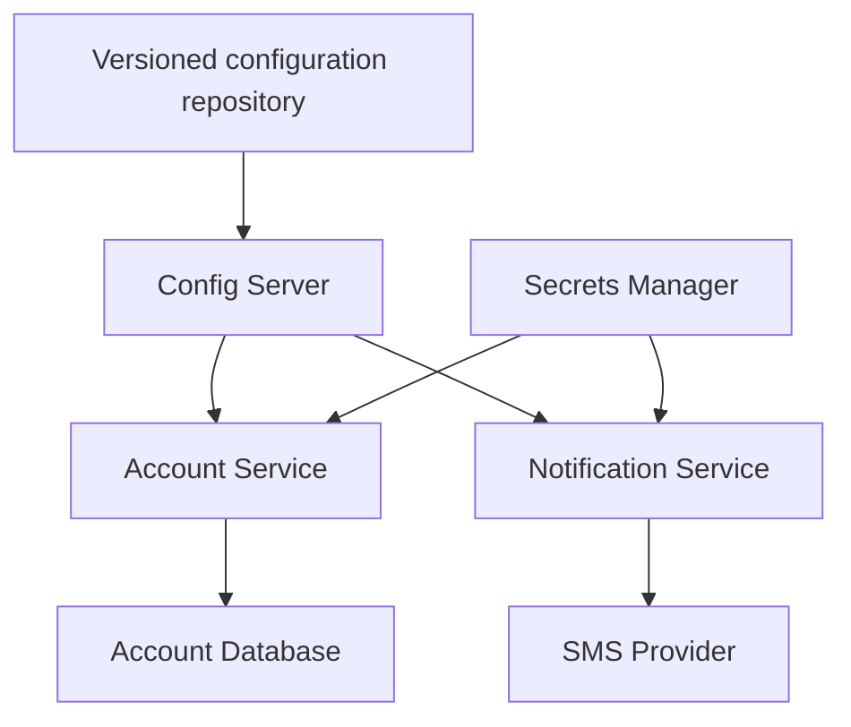

# Configuration Management

> Manage environment-specific settings and secrets through controlled storage,
> delivery, validation, rollout, and rollback.

## 1. What configuration management means

Configuration management controls application settings throughout their lifecycle:

- Where settings are stored.
- Which environment, service, and instance receives them.
- Who can read or change them.
- How values are validated.
- When changes become effective.
- How changes are audited and rolled back.

For example, the same `account-service.jar` can run in development, testing,
and production while connecting to different databases.

**Build the application once, then supply appropriate configuration for each environment.**

Spring Boot supports external configuration through YAML/properties files,
environment variables, command-line arguments, and additional property sources.
Centralized configuration is one way to deliver these settings; configuration
management is the wider discipline surrounding that delivery.

### Externalized versus centralized configuration

| Approach                   | Example                                        | What it provides                                         |
|----------------------------|------------------------------------------------|----------------------------------------------------------|
| Packaged configuration     | `application.yml` inside the JAR               | Application defaults distributed with the code           |
| Externalized configuration | Deployment mounts an environment-specific file | Environment values can change without rebuilding the JAR |
| Centralized configuration  | Spring Cloud Config Server serves settings     | A shared retrieval mechanism for service configuration   |

External files can be managed consistently through deployment automation without
a Config Server. Centralization becomes useful when its operational benefits
justify the additional dependency.

## 2. Separate configuration, secrets, and business data

| Category                   | Banking example                                   | Typical location                                |
|----------------------------|---------------------------------------------------|-------------------------------------------------|
| Application configuration  | HTTP timeout, connection pool size                | Configuration files or configuration service    |
| Environment configuration  | Database URL, Kafka addresses                     | Deployment settings or configuration service    |
| Secrets                    | Database password, SMS API key                    | Secrets manager                                 |
| Feature flags              | Enable a new account summary screen               | Feature flag system or controlled configuration |
| Business data and policies | Account balance, customer-specific transfer limit | Business database or policy service             |

Examples:

- `notification.sms.timeout=3s` is application configuration.
- The SMS provider API key is a secret.
- A customer's daily transfer allowance is usually business policy.

A global `max.transfer.limit` property may suit a simple application. A bank may
need limits by customer, account type, channel, currency, and regulatory policy.
Those requirements need business modeling and audit controls beyond a generic
configuration property.

Feature flags also need ownership, an expiry or removal plan, and safe defaults.
A flag that controls authorization requires stricter treatment than a cosmetic flag.

## 3. Why this matters with many services

Consider our banking services:

- `api-gateway`
- `config-service`
- `branch-service`
- `customer-service`
- `account-service`
- `notification-service`

Each environment needs different settings:

| Service      | Development           | Testing          | Production          |
|--------------|-----------------------|------------------|---------------------|
| Account      | Development database  | Test database    | Production database |
| Notification | Fake SMS provider     | Provider sandbox | Real SMS provider   |
| Gateway      | Local allowed origins | Test frontend    | Production frontend |

Manual file edits on individual servers can cause configuration drift:

- Account instance A uses a 3-second timeout.
- Account instance B uses a 30-second timeout.
- Both run the same application version.

Requests then behave differently depending on the selected instance.

**The effective configuration should be intentional, validated, and traceable.**

## 4. Centralized configuration architecture



Config Server arrows represent retrieval during startup or an explicit refresh.
Secret delivery may use a client library, deployment integration, or mounted files;
the diagram represents the logical relationship.

### Startup sequence

1. Account Service starts.
2. It knows its application name, environment, and Config Server address.
3. It requests the corresponding configuration.
4. It obtains required secrets through the chosen delivery mechanism.
5. It validates the required settings.
6. It initializes its database pool and other components.
7. It becomes ready to serve requests.

Ordinary business requests should use configuration already available in memory.
Retrieving an account balance should not require a remote Config Server call to
retrieve the database URL each time.

## 5. Application, profile, and label

Spring Cloud Config identifies configuration using three values:

| Value       | Meaning                                     | Example           |
|-------------|---------------------------------------------|-------------------|
| Application | Which service?                              | `account-service` |
| Profile     | Which environment or configuration profile? | `prod`            |
| Label       | Which configuration version?                | `release-2026-10` |

A request could be:

```http
GET /account-service/prod/release-2026-10
```

The label's meaning depends on the backend:

- **Git:** a branch, tag, or commit ID.
- **JDBC:** a label value used by the repository query. History and rollback need
  their own implementation.

Do not assume that using a label automatically makes the configuration immutable.
A Git branch can move, and a JDBC row can be updated unless controls prevent it.

### Example Git repository files

| File                            | Scope                                    |
|---------------------------------|------------------------------------------|
| `application.yml`               | Shared defaults                          |
| `application-prod.yml`          | Shared production settings               |
| `account-service.yml`           | Account Service defaults                 |
| `account-service-prod.yml`      | Account Service production settings      |
| `notification-service.yml`      | Notification Service defaults            |
| `notification-service-prod.yml` | Notification Service production settings |

Service-specific and profile-specific settings override applicable defaults under
the repository's precedence rules. Keep shared settings small: a mistake in a
shared property can affect many services.

## 6. Modern Spring Boot client configuration

These snippets illustrate the Config Data import approach introduced in Spring
Boot 2.4. Select a compatible Spring Boot and Spring Cloud release combination;
do not mix dependency versions independently.

The client needs the Config Client dependency, normally managed by the compatible
Spring Cloud BOM:

```xml
<dependency>
    <groupId>org.springframework.cloud</groupId>
    <artifactId>spring-cloud-starter-config</artifactId>
</dependency>
```

In the client's local `application.yml`:

```yaml
spring:
  application:
    name: account-service
  config:
    import: "configserver:${CONFIG_SERVER_URL}"
```

The deployment supplies values such as:

```text
SPRING_PROFILES_ACTIVE=prod
CONFIG_SERVER_URL=https://config.internal.example
```

This initial configuration answers:

> Who am I, which environment am I using, and where do I obtain configuration?

Config Server cannot provide the only information required to locate itself.
Its address, access identity, and any required trust material need an independent
bootstrap mechanism.

With Config Data import, `bootstrap.yml` is not required. Older examples using
the legacy bootstrap context have different setup requirements.

### Required versus optional configuration

Required import:

```yaml
spring:
  config:
    import: "configserver:${CONFIG_SERVER_URL}"
```

Failure to obtain remote configuration can stop startup.

For deliberate local fallback:

```yaml
spring:
  config:
    import: "optional:configserver:http://localhost:8888"
```

`optional:` permits continuing when the remote source is unavailable. It does not
create missing credentials, validate settings, or guarantee successful startup.

**Suggested production policy:** fail startup when required configuration is
missing or invalid. Configure bounded startup retries where appropriate rather
than allowing an uncontrolled retry storm during an outage.

## 7. Configuration precedence

Several sources may define the same property. Understanding the effective value
is essential when troubleshooting.

For ordinary Spring Boot externalized configuration, environment variables can
override config data, and command-line arguments have higher precedence than
environment variables. Profile-specific files also participate in file precedence.

Remote imports and legacy bootstrap configuration have additional rules. Check
the documentation for the exact loading mechanism and release in use instead of
assuming that remote configuration always wins or that local configuration always wins.

Example investigation:

1. Repository says timeout is `3s`.
2. Production instance behaves as if timeout is `30s`.
3. Deployment supplies an overriding environment variable.
4. Correct the authoritative source and remove unintended overrides.

Inspect property origins through restricted diagnostics when supported. Never
expose complete configuration or secret values publicly while debugging.

## 8. Git versus JDBC storage

| Aspect                 | Git backend                           | JDBC backend                                      |
|------------------------|---------------------------------------|---------------------------------------------------|
| Change workflow        | Commit and review                     | Controlled API, administrative tool, or migration |
| History                | Git change history                    | Must implement or enable audit history            |
| Rollback               | Select or restore a known version     | Restore a previous configuration version          |
| Validation             | CI checks before merging              | Validation before committing changes              |
| Operational dependency | Repository access and server checkout | Database availability and connectivity            |

Both can be valid choices. Neither automatically updates running applications.

Your earlier notes use JDBC, with rows identified by application, profile, label,
key, and value. An illustrative update is:

```sql
UPDATE properties
SET value = '5s'
WHERE application = 'notification-service'
  AND profile = 'prod'
  AND label = 'release-2026-10'
  AND key = 'notification.sms.timeout';
```

Table and column names depend on the schema and database; some names may require
quoting. Use a controlled change process rather than ad hoc production SQL.

This updates stored configuration. It does not prove that any running instance
has fetched or applied the new value.

## 9. Storage changes versus runtime changes

Treat these as separate milestones:

1. Configuration changed in storage.
2. Config Server can serve the new version.
3. An instance fetched the new version.
4. The instance validated and successfully applied it.
5. Every intended instance successfully applied it.

**Centralized storage does not automatically mean dynamic application behavior.**

There are two main rollout approaches:

| Approach                      | How it works                                   | Useful for                                          |
|-------------------------------|------------------------------------------------|-----------------------------------------------------|
| Restart or rolling deployment | New instances load the desired configuration   | Infrastructure settings and predictable rollout     |
| Runtime refresh               | Running applications reload supported settings | Selected properties explicitly designed for refresh |

A restart does not require rebuilding the JAR when settings are externalized.

## 10. Runtime refresh in Spring

Spring Cloud supports mechanisms such as refresh-scoped beans and configuration
refresh events. A restricted Actuator refresh endpoint can trigger refresh for an
instance when configured. Spring Cloud Bus can distribute refresh events through
a supported message broker.

Neither mechanism guarantees that every component can be updated safely.

| Setting                     | Question to resolve                                            |
|-----------------------------|----------------------------------------------------------------|
| Notification message prefix | Does the code read the refreshed value?                        |
| HTTP timeout                | Can the client update it, or must the client be recreated?     |
| Database password           | Will new connections use it, and how will the pool transition? |
| Server port                 | Plan a restart                                                 |
| Payment feature flag        | Is temporary mixed behavior across instances acceptable?       |

A normal singleton containing a value injected with `@Value` is not automatically
recreated when a repository changes. Structured `@ConfigurationProperties` improves
binding and validation, but does not make arbitrary dependent resources refreshable.

Some components are excluded from refresh. Spring Cloud's documented default
never-refreshable list includes `HikariDataSource`. Check the exact release and
resource lifecycle before designing database credential refresh.

**Design and test refresh support property by property.** Protect refresh
operations with authentication, authorization, and restricted network access.

## 11. Multiple instances and configuration consistency

Suppose Notification Service has three instances:

| Instance | Successfully applied version |
|----------|------------------------------|
| A        | 41                           |
| B        | 41                           |
| C        | 40                           |

Instance C may have missed an event, failed to fetch the update, or rejected it.
A cosmetic change may tolerate this temporarily. A security or financial control
may require a coordinated rollout, readiness restrictions, or another explicit policy.

Track at least:

- Desired version for each deployment or rollout group.
- Successfully applied version per instance.
- Refresh and validation failures.
- Time spent behind the desired version.
- Whether a stale instance should continue serving traffic.

A refresh broadcast does not make updates atomic across the fleet. During a
canary rollout, different versions may be intentional; compare each instance
against the version assigned to its rollout group.

For related properties, apply a validated configuration snapshot together where
your implementation supports it. Avoid partially applying a new set of values.

## 12. Secrets management

Database passwords and API keys need a controlled lifecycle:

- Service-specific access permissions.
- Protected transport and storage.
- Audit records for secret access and changes.
- Rotation and revocation.
- Controlled delivery to applications.
- Prevention of disclosure through logs and diagnostics.

Examples of suitable systems include a dedicated secrets manager or a cloud
secret-management service. Prefer workload identity or another managed identity
mechanism when available, rather than embedding a long-lived credential used to
retrieve all other credentials.

Illustrative client configuration:

```yaml
spring:
  datasource:
    url: ${ACCOUNT_DB_URL}
    username: ${ACCOUNT_DB_USERNAME}
    password: ${ACCOUNT_DB_PASSWORD}
```

These placeholders do not secure the values by themselves. Environment variables
are one delivery option, but process inspection, deployment tools, and diagnostics
may reveal them. Mounted secret files and direct retrieval also require suitable
permissions and lifecycle handling.

Account Service should be able to obtain its database credential without
automatically receiving Notification Service's SMS key.

Avoid logging objects that contain credentials. Restrict configuration endpoints,
management endpoints, heap dumps, and other diagnostic artifacts that may contain
sensitive material. A private network alone is not an authorization policy.

## 13. Secret rotation

Suppose Account Service currently uses database credential A and must move to B.

1. Create or enable credential B.
2. Store B as the new secret version.
3. Update or restart a small number of application instances.
4. Verify that new database connections succeed using B.
5. Complete the rollout across intended instances.
6. Revoke A after the transition and verification.

An overlap period helps when the database and authentication mechanism support
it. Otherwise, rotation requires a different coordinated procedure.

Changing a value in the secrets manager does not update every application,
existing connection, or connection pool. Verify authentication through new
connections before revoking the old credential.

If a credential is compromised, prioritize revocation and incident containment;
a routine overlap procedure may no longer be appropriate.

## 14. Config Server outage behavior

| Situation                                    | Behavior to design and test                                                          |
|----------------------------------------------|--------------------------------------------------------------------------------------|
| Running instance has already loaded settings | Usually continues with its current in-memory configuration                           |
| New instance requires remote configuration   | May fail startup or retry                                                            |
| Running instance attempts refresh            | Refresh may fail; retain the last successfully applied configuration where supported |
| Secret expires during the outage             | New authentication attempts may fail even while configuration remains loaded         |

Do not assume that Config Client automatically has a durable cache that survives
process restarts. If offline startup from a previous configuration is required,
design and test it, including version age, secret expiry, and invalidation rules.

### Availability measures

- Run multiple Config Server instances across failure domains when required.
- Provide a stable endpoint or supported client failover configuration.
- Consider backing repository, database, and secrets-system availability.
- Use bounded retries with backoff and jitter where supported.
- Test recovery under a large number of simultaneous service restarts.

Multiple Config Servers do not solve an outage of their shared backing database.
Also avoid circular startup dependencies: if Config Server is located through
Eureka, the client still needs enough independent configuration to reach Eureka.

## 15. Validate configuration before using it

A syntactically valid setting can still cause an outage:

```yaml
notification:
  sms:
    timeout: 1ms
```

Useful validation includes:

- Required values must exist.
- Types and formats must be correct.
- Timeouts must be positive and suitable for the dependency.
- Pool capacity must fit the database's approved connection budget.
- Production must not accidentally target a development database.
- Required secret references must resolve.
- Related values must satisfy cross-field constraints.
- Configuration must remain compatible with application versions still running.

Prefer grouped `@ConfigurationProperties` with explicit validation to many
scattered values. Bean Validation requires the appropriate validation dependency
and validation setup; custom constraints may be needed for units and relationships.

### Capacity example

If 30 instances each have a maximum pool size of 20:

```text
30 × 20 = 600 potential database connections
```

Increasing each pool to 100 gives:

```text
30 × 100 = 3,000 potential database connections
```

Include temporary extra instances during rolling deployments and other database
clients in the capacity budget.

## 16. Safe change workflow

1. Propose a versioned change.
2. Validate required values, types, ranges, and relationships.
3. Review affected services and compatible application versions.
4. Test in an appropriate environment.
5. Apply to a small subset of instances.
6. Observe errors, latency, resource use, and applied versions.
7. Expand the rollout or roll back.

Audit who changed what, when, why, and which version was applied. Avoid recording
plaintext secret values in the audit trail.

Rollback requires both restoring a suitable configuration version and ensuring
instances actually apply it. A Git revert alone does not roll back running beans.
Revoked credentials may require issuing a new secret rather than restoring an old one.

## 17. Common mistakes

| Mistake                                        | Better approach                                       |
|------------------------------------------------|-------------------------------------------------------|
| Assuming a DB update refreshes all clients     | Track retrieval and successful application separately |
| Storing plaintext secrets in Git               | Use a controlled secrets-management mechanism         |
| Using `optional:` everywhere                   | Decide explicitly which settings are mandatory        |
| Fetching config during every business request  | Load locally and use controlled refresh               |
| Assuming every bean supports refresh           | Test the lifecycle of each affected resource          |
| Manual edits on individual servers             | Use a versioned, repeatable rollout                   |
| Putting every setting in shared defaults       | Limit shared scope to reduce blast radius             |
| Exposing refresh or environment endpoints      | Restrict operational access and sensitive output      |
| Treating a broadcast as an atomic fleet update | Monitor per-instance application and convergence      |
| Assuming in-memory config survives restart     | Design offline startup explicitly if required         |

## 18. Connections to previous system design topics

| Topic               | Connection                                                                         |
|---------------------|------------------------------------------------------------------------------------|
| Service discovery   | Supplies changing instance addresses; configuration supplies settings and policies |
| Load balancing      | Timeouts and connection settings influence failure behavior                        |
| Availability        | Config and secret dependencies can block startup or recovery                       |
| Consistency         | Instances may temporarily use different configuration versions                     |
| Observability       | Operators need each instance's actual applied version                              |
| Security            | Configuration and secret access require appropriate permissions                    |
| Capacity estimation | A shared setting can multiply resource use across all instances                    |

## 19. Bank-Microservices hands-on exercise

Start with Notification Service and a harmless message prefix or timeout setting.
Use development environments and a fake provider for the experiments.

1. Supply different non-secret settings for `dev` and `test`.
2. Bind them using validated `@ConfigurationProperties`.
3. Run two instances with unique identities.
4. Record the configuration version successfully applied by each instance.
5. Change a setting centrally and observe that storage changes alone are insufficient.
6. Use a restart rollout, then separately test an explicitly supported refresh path.
7. Stop Config Server and compare an existing instance with a newly starting one.
8. Introduce an invalid configuration and verify rejection without silently accepting it.
9. Restore a known version and verify both instances converge.

Success means you can explain the stored version, fetched version, and active
version, plus the behavior when configuration is unavailable or invalid.

## 20. Practice exercise — questions and reference answers

### Question 1: Where should an SMS timeout, SMS API key, and customer-specific transfer limit each live?

**Answer:**

| Item                             | Location                                                    | Reason                                                                       |
|----------------------------------|-------------------------------------------------------------|------------------------------------------------------------------------------|
| SMS timeout                      | Application configuration file or centralized configuration | An operational setting that may differ by environment                        |
| SMS API key                      | Secrets manager with controlled delivery                    | A credential requiring restricted access, rotation, and revocation           |
| Customer-specific transfer limit | Business database or policy service                         | Customer-specific business policy requiring appropriate validation and audit |

For example, Notification Service can load `notification.sms.timeout=3s` through
Config Server and obtain its API key through the approved secrets integration.
Account Service consults the relevant customer policy when authorizing a transfer.

### Question 2: If you update a configuration database row, do all three running instances immediately use the new value?

**Answer: No.** The database now contains the new value, but running instances may
still hold the old configuration in memory.

The new value becomes active only after each instance retrieves, validates, and
applies it through a supported refresh mechanism or restart.

Even a refresh broadcast can produce temporary differences:

| Instance | Outcome                             |
|----------|-------------------------------------|
| A        | Fetched and applied version 42      |
| B        | Fetched and applied version 42      |
| C        | Fetch failed; still uses version 41 |

Monitor successful application per instance. Do not mark a rollout complete
solely because an update event was published.

### Question 3: Should Account Service start in production when required database configuration is unavailable?

**Answer: It should not become ready to accept normal account requests without valid required database configuration.**

For our example, the suggested policy is to fail startup after bounded retries
when mandatory configuration is unavailable or invalid.

Never silently fall back to a development database, guessed credential, or unsafe
default. An alternative design can keep a process alive but not ready while it
waits for required dependencies; that behavior must be explicit and tested.

Existing healthy instances that already loaded valid settings may continue
serving traffic, subject to their dependencies and credential validity.

### Question 4: What is the difference between changing a database password in a secrets manager and successfully rotating it?

**Answer:** Updating the stored secret changes one source value. Successful
rotation coordinates the database credential, secret distribution, application
instances, connection pools, verification, and revocation.

A complete rotation requires:

1. A valid new credential at the database.
2. Authorized applications obtaining that credential.
3. New connections successfully authenticating with it.
4. Completion across intended instances.
5. Revocation of the old credential after the planned transition.

Existing pooled connections may hide a problem because they remain open. Verify
new connections instead of relying only on successful requests through old ones.

### Question 5: How would you detect that one instance still uses an older configuration version?

**Answer:** Compare the desired version for the deployment or rollout group with
each instance's last successfully applied version.

Expose safe operational metadata through a restricted information endpoint,
structured startup/refresh logs, or another controlled telemetry mechanism:

```json
{
  "service": "notification-service",
  "instance": "notification-3",
  "desiredConfigVersion": "42",
  "appliedConfigVersion": "41",
  "lastApplyResult": "FETCH_FAILED"
}
```

This is an illustrative custom representation, not a built-in Spring response.
Update the applied version only after validation and application succeed.
Record refresh failures and alert when an unintended mismatch exceeds the
allowed convergence window.

Never expose actual secrets. Prefer bounded metrics for mismatch counts and use
logs or restricted metadata for detailed version identifiers to avoid unbounded
metric cardinality.


> Remember: a configuration value is operationally changed only when the intended
> application instances successfully use it.

