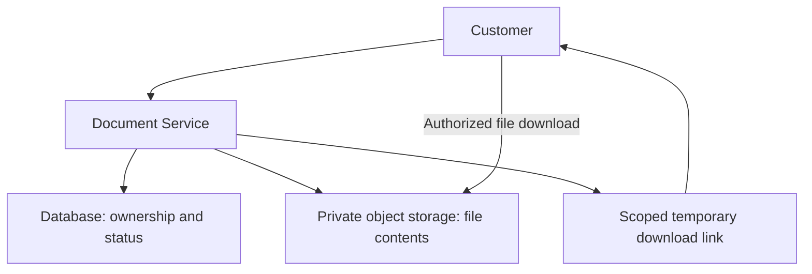
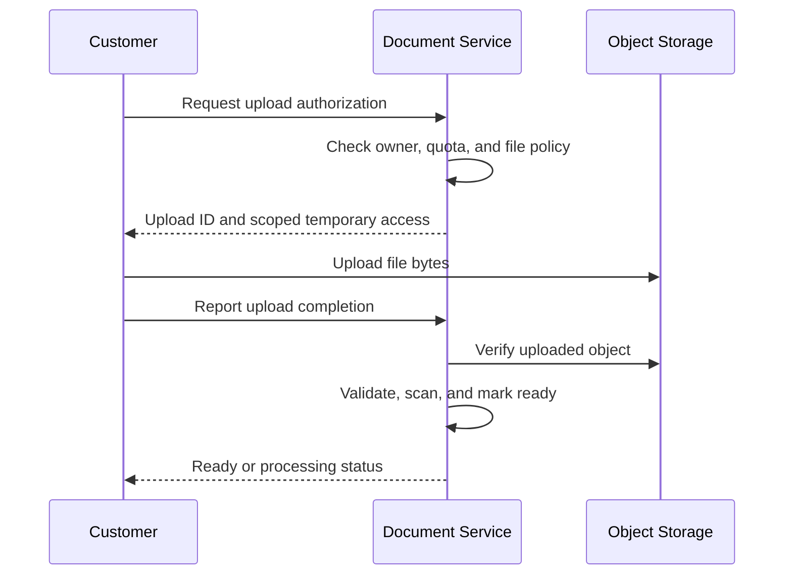

# Object Storage

> Store files as objects addressed by keys. Keep business ownership and workflow
> metadata in the application database, and authorize access before exposing files.

## 1. Introduction

Our banking application produces and receives different kinds of data:

| Data                     | Example                                                    |
|--------------------------|------------------------------------------------------------|
| Structured business data | Accounts, balances, transactions                           |
| Documents                | Statements, application forms, uploaded identity documents |
| Public assets            | Bank logo, product images, public brochures                |
| Operational files        | Exports and backups                                        |

A relational database is useful for relationships, constraints, transactions,
and queries. Object storage is useful for storing and retrieving file contents.

A common design stores a statement PDF in object storage and stores its owner,
storage key, generation date, and processing status in the application database.

Examples of object-storage services include OCI Object Storage, Amazon S3,
and Azure Blob Storage. Their APIs and capabilities differ; verify the provider
and release before implementing provider-specific behavior.

## 2. Object, bucket, key, and metadata

| Term               | Meaning                                           | Example                           |
|--------------------|---------------------------------------------------|-----------------------------------|
| Object             | Stored bytes with associated metadata             | A statement PDF                   |
| Bucket             | A container for objects                           | `bank-private-documents`          |
| Key or object name | Identifier inside a bucket                        | `statements/2026/10/doc-7a29.pdf` |
| System metadata    | Properties such as size and content type          | `application/pdf`                 |
| Custom metadata    | Application-defined attributes                    | `document-type=statement`         |
| Version identifier | Identifier for an object revision where supported | Provider-generated version ID     |

For our example:

```text
Bucket: bank-private-documents
Key:    statements/2026/10/doc-7a29.pdf
Bytes:  PDF contents
Type:   application/pdf
```

Slashes commonly organize keys into prefixes. Do not assume they represent
ordinary filesystem directories with filesystem rename and permission semantics.

Generate storage keys on the server. Avoid sensitive information such as account
numbers, email addresses, or identity numbers in names that may appear in logs.

An unpredictable key reduces accidental discovery, but it is not authorization.

## 3. Object storage versus file storage, block storage, and databases

| Storage type        | Access model                                         | Typical use                          |
|---------------------|------------------------------------------------------|--------------------------------------|
| Object storage      | API operations on named objects                      | Documents, media, exports, backups   |
| File storage        | Files and directories through a filesystem interface | Shared filesystem workloads          |
| Block storage       | Disk-like blocks attached to compute                 | Database volumes and server disks    |
| Relational database | Rows, SQL, constraints, transactions                 | Accounts, payments, business records |

Object storage is not a normal disk attached to Spring Boot. Applications normally
use an SDK or HTTP API to upload and download objects.

Treat ordinary file updates as writing a replacement object unless the provider
explicitly offers another operation. Avoid assuming support for arbitrary
in-place edits or filesystem locking.

Storing BLOBs in a database is valid in some systems, particularly when small
payloads and transactional coupling justify it. Choose based on size, access
patterns, operational needs, and transaction requirements rather than a blanket rule.

## 4. Banking architecture



The link represents a possible delivery mechanism. Sensitive documents can also
be streamed through the application when stricter per-request control is needed.

Suggested database record:

| Field                           | Purpose                                                   |
|---------------------------------|-----------------------------------------------------------|
| `document_id`                   | Stable application identifier                             |
| `customer_id`                   | Business ownership                                        |
| `document_type`                 | Statement, form, or another category                      |
| `bucket` and `object_key`       | Location of the file                                      |
| `object_version`                | Exact stored version if required                          |
| `content_type` and `size_bytes` | Verified file attributes                                  |
| `checksum`                      | Integrity verification using the chosen algorithm         |
| `status`                        | Uploading, scanning, ready, rejected, or deletion pending |
| `created_at`                    | Audit and lifecycle information                           |

Store the stable object reference, not a temporary access URL. Expiring URLs are
generated when an authorized user needs access.

## 5. Upload approach A: through Spring Boot

1. Customer authenticates and uploads to Document Service.
2. The service checks permissions, quotas, and request limits.
3. It streams the file to a private staging area in object storage.
4. Validation and malware scanning run as required.
5. The service marks the document ready only after successful checks.

| Advantage                          | Tradeoff                                                 |
|------------------------------------|----------------------------------------------------------|
| Central control over the data path | Application carries upload bandwidth                     |
| Straightforward client flow        | Large uploads need timeout and capacity planning         |
| Easier request-level inspection    | Care is needed to avoid buffering entire files in memory |

Use streaming where appropriate. A 500 MB upload should not require allocating
a 500 MB Java byte array for every simultaneous request.

## 6. Upload approach B: directly to object storage

The backend authorizes the operation, but the browser sends the bytes to storage.



Important design decisions:

- Generate a unique staging key on the backend.
- Scope access to the intended object and operation where supported.
- Use a short validity period appropriate to the upload.
- Configure CORS for allowed browser origins; CORS is not authentication.
- Never trust a client completion message as proof of a valid upload.
- Verify the stored object's size, contents, and other required attributes.
- Keep unverified uploads unavailable for normal downloads.
- Prevent an outstanding upload capability from replacing a file after validation.

The last point matters: some temporary upload grants permit repeated writes.
Design finalization using immutable final keys, a verified version reference,
conditional operations, revocation, or another provider-supported mechanism.

Direct upload reduces application bandwidth, but the backend still owns
authorization, validation, document state, and cleanup.

## 7. Temporary access links and OCI PARs

A temporary access link grants specified access without giving the client the
application's long-lived cloud credentials.

OCI provides **Pre-Authenticated Requests (PARs)**. They can grant access to a
specific object, a prefix, or a bucket depending on the selected scope. A PAR
expires and can be revoked by deleting it. Its validity also depends on the
creator retaining the required permissions.

Anyone holding a usable PAR URL can exercise the access it grants. Treat it as
a credential: avoid logging it, sharing it broadly, or using unnecessarily broad
permissions. Provider-specific PAR behavior is not identical to every other
provider's presigned URL mechanism.

For a customer statement, prefer object-specific, read-only access with a short
expiry when this delivery model is appropriate.

**An expiring URL is not automatically single-use.** Implement a different flow
if the business requires one-time access or authorization on every download.

## 8. Private download flow

Example application endpoint:

```http
GET /api/documents/doc-7a29/download
Authorization: Bearer <customer-token>
```

The backend should:

1. Authenticate the customer.
2. Load the document's business record.
3. Verify customer ownership and applicable access policy.
4. Verify that the file is ready and available.
5. Record the access decision without leaking temporary credentials.
6. Stream the file or issue a scoped temporary link.

Never authorize access solely because the caller knows `document_id` or an object key.

| Delivery model          | Useful when                                                                       |
|-------------------------|-----------------------------------------------------------------------------------|
| Stream through backend  | Central control on each request is required                                       |
| Direct temporary link   | Offloading download bandwidth is useful and capability-based access is acceptable |
| Controlled CDN delivery | Edge delivery is needed with explicitly designed private-content controls         |

Deleting or revoking a link does not erase a copy already downloaded by a user.

## 9. Database and object storage are separate systems

Uploading a file and inserting its database record generally do not form one
ordinary database transaction.

| Failure                          | Possible result                                |
|----------------------------------|------------------------------------------------|
| Upload succeeds; DB update fails | Object exists without a ready record           |
| DB record created; upload fails  | Record points to an incomplete or absent file  |
| Response times out after upload  | Client cannot tell whether the write succeeded |
| Client retries with a new key    | Duplicate objects and records                  |

Suggested workflow:

1. Create an upload record in `UPLOADING` state with an idempotency key.
2. Allocate a unique staging object key.
3. Upload or authorize the upload.
4. Verify the object and required checks.
5. Transition the record to `READY` only after finalization succeeds.
6. Reconcile abandoned records and unreferenced objects after a safe grace period.

Retries should reuse the intended operation identity. If publishing an event
after the database transition, a transactional outbox can make the database
state and event record atomic. It does not make the object upload part of the
database transaction.

## 10. Large files and multipart uploads

Multipart upload divides an object into independently uploaded parts, followed
by a completion operation.

For a hypothetical 1 GB export:

```text
Upload parts -> retry failed parts -> complete multipart upload
```

OCI supports parallel part uploads and retrying failed parts. Uncommitted uploads
need explicit abort or lifecycle cleanup; do not assume failed parts disappear
automatically. Select part sizes and concurrency according to the provider and SDK.

This is a storage API mechanism, distinct from the browser's HTTP
`multipart/form-data` format used to submit forms and files.

## 11. Security and validation

Suggested controls for our banking application:

- Keep customer-document buckets private.
- Separate public assets from private documents with appropriate permissions.
- Give each service only the storage actions it needs.
- Use managed workload identity where available instead of embedding cloud keys.
- Protect transport with TLS and configure appropriate encryption at rest.
- Validate allowed file types using content inspection, not just extensions.
- Enforce size limits and quotas using mechanisms actually supported by the upload path.
- Scan untrusted files and quarantine them until checks pass.
- Serve downloads with appropriate content type and disposition.
- Avoid shared caching of sensitive documents unless a secure design explicitly permits it.
- Restrict operational logs and redact access URLs and sensitive metadata.

Encryption protects stored bytes; it does not replace authorization. A correctly
encrypted object can still be exposed by an overly broad access policy.

## 12. Versioning, retention, lifecycle, and replication

| Feature          | Purpose                                                | Important limitation                                                             |
|------------------|--------------------------------------------------------|----------------------------------------------------------------------------------|
| Versioning       | Retain previous object revisions                       | Old versions consume storage and may still be deletable by privileged operations |
| Retention rule   | Prevent deletion or overwrite under defined conditions | Can prevent legitimate cleanup; locked settings require careful review           |
| Lifecycle policy | Transition or delete eligible resources automatically  | Processing is asynchronous and subject to retention restrictions                 |
| Replication      | Maintain another copy in a configured destination      | Does not by itself provide application failover or independent recovery history  |

OCI provides these features with provider-specific configuration and compatibility
rules. Verify which combinations are supported before enabling them.

Illustrative lifecycle policy, not a banking retention requirement:

| File category                 | Suggested learning policy                                        |
|-------------------------------|------------------------------------------------------------------|
| Temporary uploads             | Delete abandoned staging objects after a defined grace period    |
| Uncommitted multipart uploads | Abort and remove after a defined age                             |
| Old exports                   | Move to a cheaper tier when access becomes infrequent            |
| Expired records               | Delete only after the applicable retention and legal-hold checks |

OCI lifecycle rules can act on objects, old versions, and uncommitted multipart
uploads. Execution is best effort rather than an exact-time scheduler.

Do not invent a universal seven-year retention policy for all bank files. Actual
retention depends on document category, jurisdiction, business policy, and holds.

## 13. Storage tiers and retrieval tradeoffs

| Tier pattern          | Suitable workload                         | Tradeoff                                         |
|-----------------------|-------------------------------------------|--------------------------------------------------|
| Frequently accessed   | Recent documents and public assets        | Higher storage cost may buy convenient retrieval |
| Infrequently accessed | Older documents still needed occasionally | Retrieval charges or minimum durations may apply |
| Archive               | Rarely accessed long-term records         | Restore steps and retrieval delays may apply     |

Do not place a document in an archival tier while promising immediate access
unless the service design accounts for retrieval behavior.

Archive flow example:

```text
Customer requests old statement
-> Application starts restoration if needed
-> Customer sees a processing status
-> Download becomes available after restoration
```

Prices, thresholds, and retrieval times vary. Check current provider terms for
the exact tier instead of relying on generic estimates.

## 14. Consistency, durability, and availability

These are separate properties:

- **Consistency:** what subsequent reads observe after a write.
- **Durability:** whether stored data survives failures.
- **Availability:** whether the service can process a request now.

OCI documents strong consistency for its Object Storage service. Do not assume
all object storage is eventually consistent. Also do not extend that guarantee
to an external CDN cache, asynchronous replication, or a separate database.

For example, a successful origin update can coexist with an old CDN response
until the cache policy causes replacement or invalidation.

Durable storage also does not remove the need for protection against accidental
deletion, compromised credentials, and configuration errors. Test recovery.

## 15. Object storage and CDN work together

| Component           | Responsibility                                  |
|---------------------|-------------------------------------------------|
| Object storage      | Holds authoritative file contents               |
| CDN                 | Caches eligible responses near users            |
| Application service | Owns business permissions and workflows         |
| Database            | Stores ownership, status, and business metadata |

For a public logo, use a versioned key such as `assets/logo.a81f2.png`, serve it
through the CDN, and configure suitable caching.

For a private statement, authorize the user first and select a private delivery
mechanism. Static content is not automatically public content.

## 16. Spring Boot responsibilities

A Document Service commonly contains:

| Layer             | Responsibility                                         |
|-------------------|--------------------------------------------------------|
| Controller        | Accept request and return an upload or download result |
| Service           | Authorize ownership, enforce rules, coordinate state   |
| Repository        | Persist document metadata and workflow status          |
| Storage adapter   | Call the provider SDK for objects and temporary access |
| Background worker | Scan, reconcile, clean up, or restore files            |

Keep the provider SDK behind an application interface where useful:

```java
public interface DocumentStorage {
    StoredObject upload(UploadSource source);
    ObjectDetails inspect(ObjectReference reference);
    DownloadAccess createDownloadAccess(ObjectReference reference);
    void delete(ObjectReference reference);
}
```

This is illustrative Java design, not a complete SDK integration; the types are
application-defined. Their contracts should specify streaming, identity,
timeouts, version handling, and error behavior.

## 17. Capacity and observability

Hypothetical statement workload:

```text
1 million statements/month × 200 KB = approximately 200 GB/month
12 months = approximately 2.4 TB of original document contents
```

These decimal estimates exclude versions, replicas, staging files, and overhead.
Do not confuse storage growth with download traffic: one object can be downloaded
many times.

Monitor:

- Upload and download latency and error rates.
- Ready versus stuck or rejected documents.
- Age and size of abandoned uploads.
- Storage growth, old versions, and uncommitted multipart parts.
- Authorization failures and unusual access patterns.
- Restore backlog and processing time.
- Storage, request, retrieval, replication, and data-transfer costs as applicable.

## 18. Hands-on exercise for Bank-Microservices

Use synthetic files and a development bucket:

1. Create a private document bucket and a separate public-asset path or bucket.
2. Add a Document Service record with owner, key, size, and status.
3. Implement one upload path with validation and a clear ready-state transition.
4. Implement owner-authorized download.
5. Test that a second customer cannot download the first customer's document.
6. Simulate upload success followed by a database failure; reconcile the orphan.
7. Retry the same upload request and verify idempotent operation handling.
8. Test expiry and revocation of temporary access.
9. Test version recovery and development-only cleanup policies.
10. Put a public logo behind the CDN and compare storage with delivery responsibilities.

## 19. Practice questions and reference answers

### Question 1: Where should a statement PDF and its ownership information live?

**Answer:** Store PDF bytes in private object storage. Store customer ownership,
document ID, object reference, status, and business metadata in the database.
Authorize using the database record before permitting download.

Database BLOB storage can be a valid alternative when its transaction and
operational benefits justify it; object storage is our chosen design here.

### Question 2: Is `statements/2026/10/doc-7a29.pdf` an ordinary filesystem path?

**Answer:** It is an object key in our design. The slashes form a naming prefix.
Do not assume filesystem directory permissions, atomic directory rename, or file
locking. Bucket and object access must follow the provider's permission model.

### Question 3: Why use direct upload instead of sending every byte through Spring Boot?

**Answer:** Direct upload offloads file-transfer bandwidth and reduces the need
for application instances to hold upload connections. The backend still verifies
the user, selects the destination, controls access, verifies the object, and
coordinates scanning and readiness. Direct upload is not permission-free upload.

### Question 4: Does an unguessable object key make a customer statement secure?

**Answer: No.** Use private storage and verify the caller's ownership or approved
access policy. Anyone who obtains an otherwise public URL could access it, even
if the key was originally difficult to guess.

### Question 5: Is a temporary download URL single-use or permanently tied to the logged-in customer?

**Answer:** Not by default. It is a scoped access capability whose exact semantics
depend on the provider. Anyone possessing a usable link may exercise it within
its permissions and validity conditions. Use short expiry, appropriate scope,
careful handling, and revocation where supported. Use another flow when every
download requires a fresh identity check.

### Question 6: Upload succeeds but the database update fails. What should happen?

**Answer:** Keep the upload operation identifiable through its upload record,
idempotency key, and object key. Retry or reconcile the database transition after
verifying the object. If the operation was abandoned, remove the orphan only
after a safe grace period and retention checks. Do not claim that a database
rollback automatically removes an uploaded object.

### Question 7: Why use multipart upload for a large export?

**Answer:** Parts can be uploaded concurrently where appropriate, and a failed
part can be retried without resending the entire object. The upload must be
completed after successful part uploads. Abort abandoned operations or configure
cleanup so uncommitted parts do not accumulate and incur storage charges.

### Question 8: How do versioning, retention, and lifecycle differ?

**Answer:** Versioning preserves revisions. Retention restricts deletion or
overwrite under defined rules. Lifecycle automation moves or deletes eligible
resources. They address different problems and can interact; verify provider
compatibility and retention restrictions before enabling cleanup.

### Question 9: Should the bank logo and a customer's statement PDF have the same access policy?

**Answer: No.** A public logo can be shared and cached through a CDN. A statement
contains private customer information and requires authorization and controlled
delivery. Both are files, but their access requirements differ.

### Question 10: Does strong object-storage consistency guarantee that the CDN and database show the new file immediately?

**Answer: No.** Object-storage consistency applies to its documented operations.
A CDN can retain a cached response, and the database is a separate system with
its own transaction and workflow state. Coordinate object publication, metadata,
and cache behavior explicitly.

### Question 11: An archived statement must be restored before reading. What should the API do?

**Answer:** Expose an explicit processing or restore status, start or reuse an
idempotent restoration request, and provide download access when the object is
available. Do not promise an immediate file response if the chosen tier cannot
provide one.

### Question 12: Should we store a temporary access URL in the document table?

**Answer:** Store a stable bucket/key reference and an exact version when needed.
Generate temporary access after authorization. Persisting an expiring access URL
as the document location creates broken references and unnecessary credential
exposure.

## 20. Revision checklist

- Object storage contains bytes addressed by keys within buckets.
- Business metadata and authorization belong in the application design.
- Direct upload changes the byte-transfer path, not backend responsibility.
- Temporary URLs are credentials and are not automatically single-use.
- Database transactions do not automatically include object-storage writes.
- Use explicit states, idempotency, finalization, and reconciliation.
- Plan multipart cleanup, version costs, retention, and restoration.
- Distinguish consistency, durability, availability, and CDN freshness.
- Verify access controls and recovery through practical failure tests.

